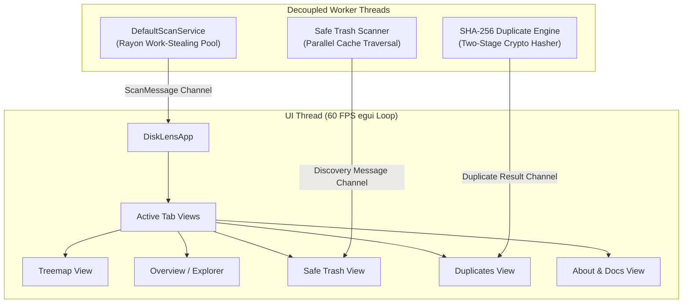

# DiskLens: Architectural & Concurrency Specification

This document details the internal subsystems, concurrency model, and dataflow pipelines powering **DiskLens**.

---

## 1. Core Architectural Model

DiskLens is constructed as an immediate-mode native Linux desktop application using `eframe`/`egui`. It follows strict separation between:
1. **The UI Thread (Immediate-Mode Rendering Loop)**: Runs at a consistent 60 FPS on GPU hardware pipelines (Wayland / X11). The UI never performs synchronous filesystem disk I/O.
2. **Background Worker Threads (Non-Blocking Compute)**: Large-scale filesystem traversals, multi-core cache enumeration, and cryptographic hashing run in decoupled threads over `crossbeam-channel` rings.

---

## 2. Filesystem Crawling & Rayon Parallelization

Filesystem indexing is performed by `DefaultScanService` using work-stealing concurrency:
- **statx Optimization**: Traversal leverages Linux `statx` system calls for accelerated metadata retrieval.
- **-xdev Isolation**: Respects filesystem boundary semantics. The scanner records root device IDs and refuses to cross into separate mounts, Btrfs subvolumes, or pseudo-filesystems (`/proc`, `/sys`).
- **Cancellation & Flow Control**: Communicates via unbounded `crossbeam-channel` queues, with atomic cancellation handles allowing instantaneous pause, resume, or abort.

---

## 3. Safe Trash Non-Blocking Traversal

Inspection of system and user caches (such as `~/.cache` containing 300,000+ files across browsers and toolchains) runs in dedicated background discovery threads:
- Traversal runs in parallel using `rayon` + `walkdir`.
- Batched statistics are transferred to `SafeTrashViewState` via non-blocking channels (`try_recv`).
- Zero UI thread freezing or "Force Quit or Wait" dialogs occur during cache discovery.
- Safe operations adhere to the FreeDesktop.org Trash specification, relocating items to `~/.local/share/Trash` with timestamped metadata.

---

## 4. Squarified Treemap Algorithm

Visual directory exploration utilizes squarified treemaps based on the Bruls, Huizing, and van Wijk algorithm:
- Rectangles are subdivided to optimize aspect ratios toward 1.0 (squares), maximizing readable label space.
- Interactive clipping ensures sub-pixel nodes are culled, maintaining high frame rates even on millions of inodes.
- Breadcrumb trails enable instant upward zooming without reparsing the underlying data model.

---

## 5. Centralized Metadata & GitHub Readiness

All versioning, author attribution (**Sayantan Mazumdar**), engine identification, and external repository links are centralized in `src/metadata.rs`.
- The UI gracefully adapts between published and unpublished states.
- Offline license viewing is provided directly through an embedded GPL-3.0 modal dialog.
