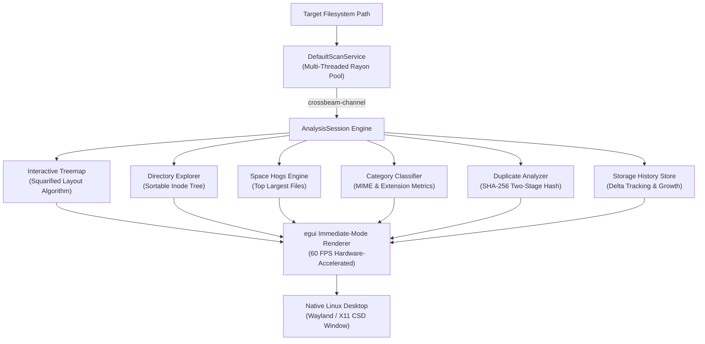

# DiskLens: High-Performance Linux Disk Space Analyzer

<p align="center">
  
  
  
  
  
  
</p>

---

## 🌟 Overview

**DiskLens** is a native, immediate-mode Linux disk space analyzer and storage reclamation suite built entirely in **safe Rust** with `eframe`/`egui`.

Developed by **Sayantan Mazumdar**, DiskLens is designed for speed, system isolation, and non-destructive reclamation:
* **Sub-Second Multi-Core Crawling:** Parallel filesystem traversal powered by `rayon` work-stealing thread pools and optimized Linux `statx` system calls.
* **Zero UI Latency:** Full immediate-mode architecture running on GPU hardware acceleration (Wayland & X11) at a constant 60 FPS.
* **Non-Blocking Background Pipeline:** Large-scale storage audits, multi-core trash inspection, and SHA-256 duplicate hashing run in isolated background threads over `crossbeam-channel` rings—eliminating UI freezes and OS "Force Quit or Wait" stalls.
* **Strict Linux Boundary Isolation:** Enforces `-xdev` mount boundary safety, preventing accidental scanning leaks across Btrfs subvolumes, mounted network shares (NFS/CIFS), or kernel pseudo-filesystems (`/proc`, `/sys`).
* **Non-Destructive FreeDesktop Reclamation:** Compliant with FreeDesktop.org Trash specifications. Reclaimed items are safely relocated to `~/.local/share/Trash` with timestamped metadata rather than irreversible unlinking.

---

## 🚀 Key Capabilities

### 1. 📊 Interactive Squarified Treemap
* Proportional space allocation using the squarified treemap layout algorithm.
* **Interactive Drill-Down:** Click on any block to zoom deep into nested directory hierarchies.
* **Dynamic Breadcrumb Trail:** Instant upward and lateral navigation with single-click breadcrumbs.
* **Depth & Threshold Sliders:** Fine-tune visible recursion depth and filter out trivial files.

### 2. 🛡️ Non-Destructive Safe Trash Manager
* Instant background categorization across user cache directories (`~/.cache/google-chrome`, `uv`, `electron`, `thumbnails`, etc.).
* Non-blocking discovery thread prevents UI stutter even with hundreds of thousands of cached files.
* Selective item inspection, batch purge, and safe FreeDesktop trash migration.

### 3. 🔍 Cryptographic SHA-256 Duplicate Detector
* Two-stage duplicate detection pipeline:
  1. *Quick Sparse Size Binning:* Fast hash grouping of candidate files.
  2. *Cryptographic Verification:* Multi-threaded byte-level SHA-256 validation to identify identical space hogs.

### 4. 🩺 Kernel S.M.A.R.T. Drive Diagnostics
* Telemetry extraction for NVMe, SATA, and SCSI drives.
* Monitors temperature, reallocated sector counts, power-on hours, and overall hardware health percentages.

### 5. 🖴 Mounts, Btrfs & Subvolume Explorer
* Full visual mapping of Linux block devices, mount points, and Btrfs subvolumes.
* Displays filesystem types (`ext4`, `btrfs`, `xfs`, `vfat`), available headroom, and mount flags (`rw`, `noatime`, `subvol`).

### 6. 📈 Storage History & Growth Trends
* Local storage delta tracking: records changes across rescan cycles.
* Provides growth analytics and identifies fast-expanding directories over time.

---

## 🏗️ Architecture Pipeline



---

## ⌨️ Universal Keyboard Shortcuts

| Shortcut | Destination / Action |
|---|---|
| `Ctrl+K` | Open Global Command Palette & Quick Search |
| `Alt+Left` / `Alt+Right` | Universal History Back / Forward Navigation |
| `1` | Jump to **Overview** Dashboard |
| `2` | Jump to **Duplicates** Finder (SHA-256) |
| `3` | Jump to **Trash** Manager |
| `4` | Jump to **History** & Growth |
| `M` | Jump to **Volumes** & Mount Points |
| `H` | Jump to **Drive Health** (S.M.A.R.T.) |
| `L` | Jump to System **Logs** |
| `D` | Jump to **About** Page |
| `R` | Trigger Instant Rescan of Target Directory |
| `T` | Toggle Dark / Day Theme Mode |
| `,` or `S` | Open Settings & Exclusion Rules |
| `Esc` | Dismiss Open Modals |

---

## 🛠️ Build & Installation

### Prerequisites
* **Rust**: 1.75+ (Cargo & rustc)
* **Linux Graphics Libraries**:
  ```bash
  sudo apt install build-essential libxcb-render0-dev libxcb-shape0-dev libxcb-xfixes0-dev libxkbcommon-dev libwayland-dev
  ```

### Build from Source
```bash
# Clone the repository
git clone https://github.com/smazumdar261-IN/DiskLens.git
cd DiskLens

# Compile optimized release binary
cargo build --release

# Run DiskLens
./target/release/disk-lens
```

### Running the Test Suite
```bash
cargo test --tests
```

All 33 verification and integration tests execute in sub-second time.

---

## 👤 Author & Maintainer

* **Developer & Maintainer:** **Sayantan Mazumdar**
* **GitHub:** [@smazumdar261-IN](https://github.com/smazumdar261-IN)
* **Project:** DiskLens (Native Linux Storage Analyzer)
* **License:** [GNU General Public License v3.0 (GPL-3.0)](LICENSE)
